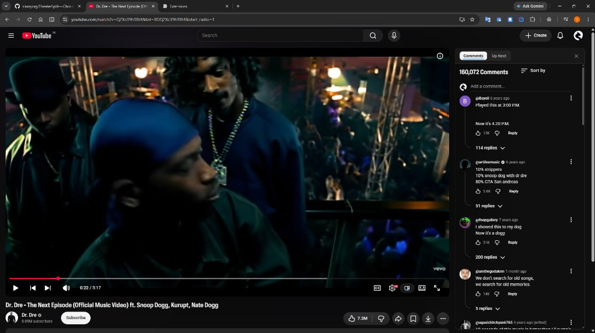
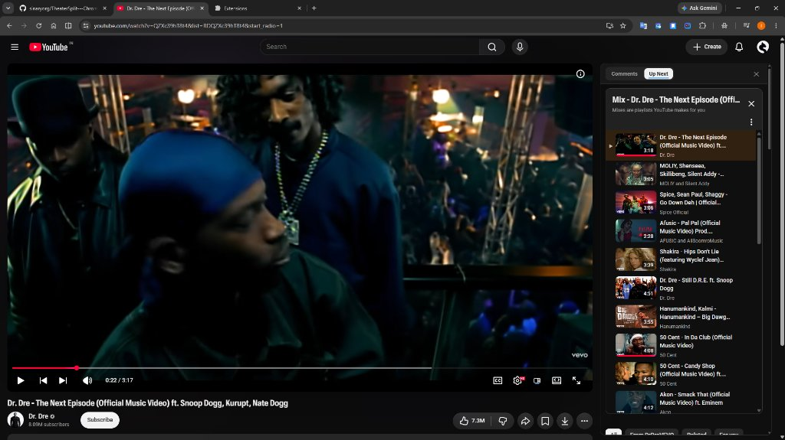
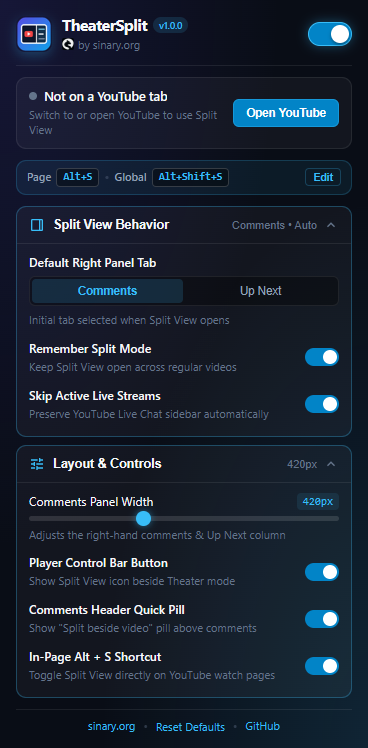
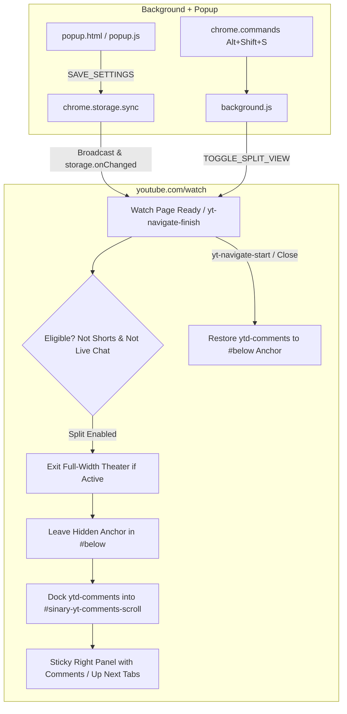

# TheaterSplit — by Sinary

<div align="center">


# 🎬 TheaterSplit
### YouTube Theater Split View (Video Left + Comments Right) for Chrome & Edge

[](https://developer.chrome.com/docs/extensions/mv3/intro/)
[](https://github.com/sinaryorg/TheaterSplit---Chrome-extension/releases/latest/download/TheaterSplit-v1.0.0.zip)
[](https://sinary.org)
[](https://www.youtube.com)
[-emerald?style=flat-square)](https://sinary.org)
[](LICENSE)
[](https://sinary.org)

**Watch regular YouTube videos on the left while reading, replying, and scrolling comments on the right — bringing Brass Browser's native Theater Split View to Google Chrome and Microsoft Edge.**

> [!NOTE]  
> **YouTube-Only Scope**: TheaterSplit is built specifically for YouTube watch pages (`https://www.youtube.com/watch*`). It never runs on or reads any other website.

[Previews](#-preview--screenshots) • [Features](#-key-features) • [Installation](#-installation--setup) • [Shortcuts & Usage](#-user-guide--shortcuts) • [Architecture](#-architecture--under-the-hood) • [Developer Guide](#-developer--contributor-guide) • [License](#-license--credits)

</div>

---

## 📸 Preview & Screenshots

<div align="center">

### 💬 Video Left + Sticky Comments Right
*Watch regular YouTube videos on the left while reading and scrolling comments in a native-styled right panel — toggled straight from the player bar.*

<br>



<br><br>

### 📺 Instant Comments / Up Next Switcher
*Switch seamlessly between **Comments** and **Up Next** recommendations (including playlists & mixes) without leaving the video.*

<br>



<br><br>

### ⚙️ Beveled Glass Settings Popup
*Customize sidebar width, default tab, live-stream preservation, in-page controls, and shortcuts from the toolbar.*

<br>



</div>

---

## 💡 Why TheaterSplit?

On live streams, YouTube places the video on the left and live chat on the right. On regular videos, comments are buried below the player — forcing you to scroll away from the video whenever you want to read replies.

**TheaterSplit** solves this cleanly without breaking YouTube's SPA navigation or theme styling:
- **Sticky Side-by-Side Layout**: Keeps the video player and metadata in the left `#primary` column while docking `ytd-comments` inside a full-height scrollable right panel (`#secondary`).
- **Seamless Theme Integration**: Automatically adapts to both YouTube Dark Mode and Light Mode using YouTube's native `--yt-spec-*` CSS variables.
- **Smart YouTube Edge Cases**: Restores comments cleanly before SPA video transitions (`yt-navigate-start`), preserves native Live Chat on livestreams, and exits cleanly when switching to Fullscreen or YouTube's full-width Theater Mode.

---

## ⭐ Key Features

- **🎛️ Native Player Bar Button**: Adds a split-screen toggle icon inside YouTube's bottom-right player bar right next to the Theater mode button.
- **💬 Comments Header Quick Pill**: Adds a subtle **"Split beside video"** pill next to the comments count header when Split View is off.
- **🗂️ Comments / Up Next Switcher & Close (`✕`)**: Switch instantly between **Comments** and **Up Next** inside the sticky right sidebar, or exit Split View anytime.
- **⏱️ Smart Timestamp Seeking**: Clicking timestamps in comments (such as `04:12`) jumps the video without scrolling the outer page away from your place in the comment thread.
- **♾️ Reliable Infinite Scroll**: Relays panel scroll events so YouTube's comment pagination continues loading replies as you scroll.
- **📡 Livestream & SPA Aware**: Remembers your split preference across regular videos while staying out of the way on YouTube Shorts and active Live Chat streams.
- **⌨️ Dual Keyboard Shortcuts**:
  - <kbd>Alt + S</kbd> — Instant in-page toggle on YouTube watch pages.
  - <kbd>Alt + Shift + S</kbd> — Global browser shortcut customizable via `chrome://extensions/shortcuts` or `edge://extensions/shortcuts`.
- **🎛️ Customizable Toolbar Popup**:
  - Live active-tab status card with one-click **Enter Split** / **Exit Split**.
  - Adjustable right sidebar width (`340px` – `560px`).
  - Toggle **Remember Split Mode**, **Skip Active Live Streams**, **Player Button**, **Comments Pill**, and **Alt + S** shortcut.
- **🔒 Privacy-First & YouTube-Scoped**: 100% local execution, zero telemetry, zero analytics, and host permissions strictly limited to `youtube.com`.

---

## 🚀 Installation & Setup

### 📦 Option A: Quick Install from GitHub Releases (Chrome & Edge — Recommended)

1. Download the latest release archive from GitHub:  
   👉 **[Download Latest Release (`TheaterSplit-v1.0.0.zip`)](https://github.com/sinaryorg/TheaterSplit---Chrome-extension/releases/latest)**
2. Extract / unzip `TheaterSplit-v1.0.0.zip` into a permanent folder on your computer.
3. Open your browser's Extensions page:
   - **Google Chrome**: `chrome://extensions`
   - **Microsoft Edge**: `edge://extensions`
4. Turn ON **Developer mode** (top-right in Chrome, left sidebar or top-right in Edge).
5. Click **Load unpacked** and select the extracted folder containing `manifest.json`.
6. Open any YouTube video (`https://www.youtube.com/watch?v=...`) and click the new Split View icon in the player bar (or press <kbd>Alt + S</kbd>)!

### 🛠️ Option B: Clone via Git (For Developers)

```bash
git clone https://github.com/sinaryorg/TheaterSplit---Chrome-extension.git
```

Then open `chrome://extensions` or `edge://extensions`, enable **Developer mode**, click **Load unpacked**, and select the cloned folder.

---

## ⌨️ User Guide & Shortcuts

| Action | Trigger / Shortcut | Description |
| :--- | :--- | :--- |
| **Toggle Split View (In-Page)** | <kbd>Alt + S</kbd> | Toggles Theater Split View on the active YouTube watch page. |
| **Toggle Split View (Global)** | <kbd>Alt + Shift + S</kbd> | Browser-level command (editable at `chrome://extensions/shortcuts` or `edge://extensions/shortcuts`). |
| **Player Control Button** | Click Split icon in player bar | Located right beside YouTube's Theater Mode button. |
| **Comments Quick Pill** | Click `Split beside video` | Appears beside the Comments header when Split View is off. |
| **Switch Right Panel Tab** | Click `Comments` / `Up Next` or <kbd>←</kbd>/<kbd>→</kbd> | Switches between Comments and Up Next recommendations inside the sticky sidebar. |
| **Exit Split View** | Click `✕` or press <kbd>Alt + S</kbd> | Cleanly restores comments beneath the video player. |

### 🧪 Interactive Offline QA Playground

A standalone simulator is included to preview and test the layout locally:
1. Open [`test_page.html`](test_page.html) in Chrome or Edge.
2. Click the Split View icon in the mock player bar, click timestamps like `04:12`, or toggle Light/Dark theme.

---

## 🏗️ Architecture & Under the Hood

TheaterSplit uses a zero-dependency **Manifest V3** architecture scoped strictly to YouTube:



### File Structure

```text
TheaterSplit/
├── manifest.json           # Manifest V3 config (storage + scripting, youtube.com host scope)
├── background.js           # Service worker: settings sync, keyboard command, tab messaging
├── content.js              # YouTube watch-page split engine & SPA lifecycle handling
├── content.css             # Native-themed sticky split layout & accessible tab/scrollbar CSS
├── popup.html              # Beveled glass settings popup markup
├── popup.css               # Popup glassmorphism stylesheet
├── popup.js                # Popup controller & active YouTube tab state sync
├── package_extension.py    # Clean release ZIP builder (dist/TheaterSplit-v<version>.zip)
├── package_extension.ps1   # PowerShell wrapper for packaging
├── test_page.html          # Offline YouTube Watch Page QA simulator
├── CHROMEWEBSTORE.md       # Chrome Web Store & Edge Add-ons listing & permission justifications
├── PRIVACY_POLICY.md       # Zero-collection privacy policy
├── LICENSE                 # MIT License
└── icons/                  # 16px, 48px, 128px extension icons & Sinary badge
```

---

## 🛠️ Developer & Contributor Guide

### 1. Prerequisites
- **Google Chrome** or **Microsoft Edge** (Manifest V3).
- [Node.js](https://nodejs.org/) (v18+) for syntax verification.
- [Python 3](https://www.python.org/) for running the automated release packager.

### 2. Local Verification & Packaging

Validate JavaScript syntax across all extension scripts:

```bash
node -c background.js content.js popup.js
```

Build a clean Chrome & Edge distribution ZIP in `dist/`:

```bash
python package_extension.py
```

Or on Windows PowerShell:

```powershell
.\package_extension.ps1
```

This creates `dist/TheaterSplit-v1.0.0.zip` containing only production extension files (automatically excluding dev/test files, git history, and store docs).

---

## 🔒 Security & Privacy

- **Zero External Requests**: No analytics, no tracking, no remote code execution, and no third-party libraries.
- **Trusted Types Safe**: All injected YouTube DOM elements are constructed with `createElement` / `createElementNS` and `textContent` rather than raw `innerHTML`.
- **Minimal Permissions**: Only requests `storage`, `scripting`, and host access strictly for `https://www.youtube.com/*` and `https://youtube.com/*`. See [PRIVACY_POLICY.md](PRIVACY_POLICY.md).

---

## 📄 License & Credits

- **Origin**: Ported from **Brass Browser**'s YouTube Theater Split View feature.
- **Author**: Crafted by **[sinary.org](https://sinary.org/)**.
- **License**: Released under the open-source [MIT License](LICENSE).
